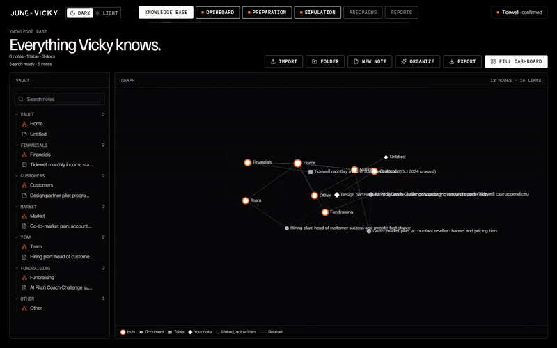
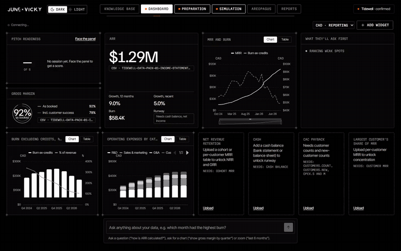
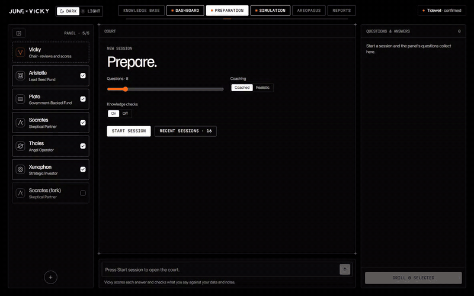
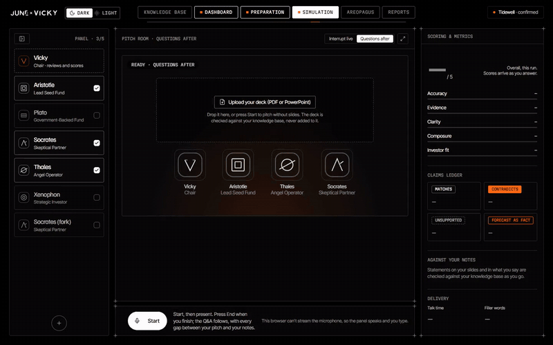
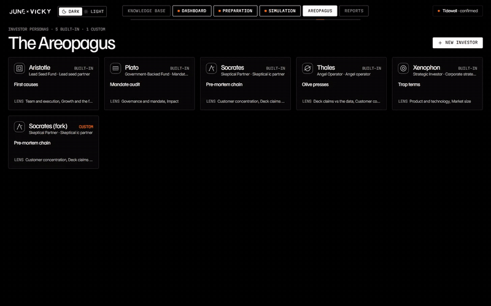
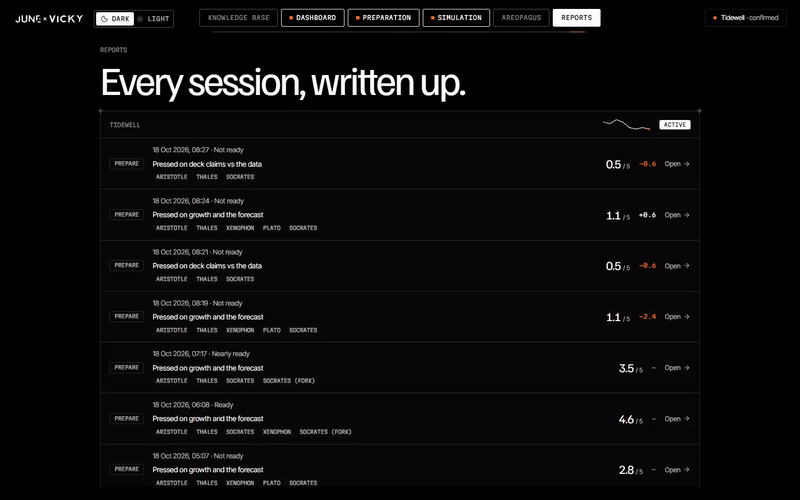

# JUNE × VICKY 

(Access Code: vicky-atlas-58d8cc)

**Vicky is an AI venture capitalist that gets founders ready to raise.** A founder brings their own financials and documents. Vicky computes every metric in code, builds a dashboard where every figure has a source, and lists what investors will ask about first. A panel of AI investors then questions the founder in a text court and in a spoken pitch room, scores every answer and writes it up as a report.

Built for the Catalyst hackathon (June Analytics, AI Pitch Coach challenge).

▶ **[Watch the full tour (5:46, MP4)](docs/demo/vicky-tour.mp4)**, or one tab at a time below.


## Ground rules

These hold everywhere in the app and are enforced in code:

- **Numbers come from code.** The metrics engine computes every figure. The model never supplies a number.
- **Every figure carries a source:** a file, a row range and a formula. An audit blocks uncited numbers and benchmarks.
- **Missing data is reported as missing**, and history is kept apart from forecasts.
- **No valuation or investment advice**, anywhere.

## Demos

Each tab has its own clip, recorded with Playwright against the running app on the sample company from the challenge pack. Clips show a visible cursor and captions. Waits for the model are played at 4–6× speed. GIFs are previews; the MP4 links are full quality.

### 0 · Landing and access ([MP4](docs/demo/00-landing.mp4))

The intro, the 3D VICKY mark and the access gate. One shared access code becomes a signed, HTTP-only cookie. Then the six tabs and the light/dark switch.


### 1 · Knowledge base ([MP4](docs/demo/01-knowledge.mp4))

Everything Vicky knows about the company. Imported CSV/XLSX, PDF, DOCX and PPTX files (scans are OCR'd) become notes in a vault. An organizer files them into folders with hub notes and `[[links]]`, drawn as a graph. Tables stay tables for the metrics engine. Search is hybrid (BM25 + pgvector) and is rebuilt on each Fill. **Fill dashboard** turns the vault into the source of truth, which the founder confirms.



### 2 · Dashboard ([MP4](docs/demo/02-dashboard.mp4))

The confirmed numbers: ARR, gross margin, MRR and burn, operating expenses, pitch readiness, and *What they'll ask first*. Every widget explains its figure, and a widget whose data is missing says so and asks for it. **Ask Vicky** answers questions about the data with footnotes, and **Chart it** pins the answer to the dashboard as a widget.



### 3 · Preparation ([MP4](docs/demo/03-preparation.mp4))

A text court. Vicky chairs a panel of up to five investor personas. Each persona asks from the founder's own numbers and notes, follows up on weak answers, and has every answer scored on accuracy, evidence, clarity, composure and investor fit. Each claim is checked against the data: *matches*, *contradicts*, *unsupported* or *forecast stated as fact*. Feedback shows the correct figure with its source and a stronger answer. Questions collect on the right, where the founder can repeat them or drill them next time.



### 4 · Simulation ([MP4](docs/demo/04-simulation.mp4))

The pitch room. The founder uploads a deck (optional), presents out loud, and the panel interrupts live or questions afterwards, each investor in their own ElevenLabs voice. The claims ledger and the *against your notes* checks fill in during the pitch, and delivery stats (talk time, filler words, seconds per slide) are tracked. The clip is typed rather than spoken, which is the app's fallback when no microphone is available.



### 5 · Areopagus ([MP4](docs/demo/05-areopagus.mp4))

The investor personas, built in or custom. Each has a lens (how hard they press on growth, retention, unit economics, governance…), a style, a signature move, opening questions and dealbreakers. **New investor** turns a one-sentence description into a full persona draft for the founder to check and save. The clip cancels the draft, so nothing is saved.



### 6 · Reports ([MP4](docs/demo/06-reports.mp4))

Every session, written up, with the score trend per company. A report covers the verdict and readiness, scores by dimension, what each investor still doubts, every question with the founder's answer, the correct figure and a strong answer, an action plan, and sources. It downloads as Markdown.



## How it works

```
browser ──HTTPS──▶ vicky-web (Next.js 16) ── /api/v1/* proxy ──▶ vicky-api (FastAPI)
        ──WSS──────────────────────────────────────────────────▶   ├── Postgres 17 + pgvector (only durable store)
                                                                     └── Redis / Valkey (jobs, pub/sub, caches, rate limit, spend cap)
```

| Layer | Stack |
|---|---|
| Frontend | Next.js 16 (App Router, standalone output), React 19, Tailwind v4, React Three Fiber, ECharts |
| Backend | Python 3.13, FastAPI, asyncpg with SQL migrations, pandas, pypdf, Tesseract OCR, arq jobs |
| Models | Claude (Opus 5.5 for memos, judge, reports and chat; Sonnet 5.5 for the panel, chair and persona drafts; Haiku 5.5 for claim extraction and routing). Offline agents run when no key is set. |
| Voice | ElevenLabs realtime speech-to-text, plus one text-to-speech voice per investor and one for Vicky |
| Retrieval | BM25 + pgvector over the knowledge base, with Voyage embeddings |
| Infra | Docker everywhere; `docker-compose.yml` locally, `render.yaml` on Render, GitHub Actions CI |

## Run it locally

You need Docker, [uv](https://docs.astral.sh/uv/) and Node 22.

```bash
cp .env.example backend/.env
```

Fill in `backend/.env`. `ACCESS_CODE` and `COOKIE_SECRET` are required. `ANTHROPIC_API_KEY`, `ELEVENLABS_API_KEY` and `VOYAGE_API_KEY` are optional: without them the app runs its offline agents, shows the panel's lines as captions, and searches by keyword only.

```bash
docker compose up -d db kv
```

```bash
uv --directory backend run uvicorn vicky.api:app --port 8000 --reload
```

```bash
npm --prefix frontend install && npm --prefix frontend run dev
```

Open http://localhost:3000, press **Get started** and enter your access code. To try the sample company, import the files in `backend/data/samples/` on the Knowledge base tab and press **Fill dashboard**.

`docker compose --profile full up` runs the whole stack (web, API, worker, Postgres, Redis) in containers instead.

## Tests

```bash
uv --directory backend run pytest
```

```bash
npm --prefix frontend run test:e2e
```

The E2E suite needs the stack running; see [frontend/README.md](frontend/README.md).

## Recording the demos

The clips above come from `frontend/demo/`: one Playwright spec per tab, with a visible cursor, captions and the waits marked to play faster. To re-record them, run the stack against a production build (the dev server's Fast Refresh shows in recordings).

```bash
npm --prefix frontend run build
```

```bash
npm --prefix frontend run start -- -p 3100
```

```bash
cd frontend && BASE_URL=http://localhost:3100 npm run demo:record
```

```bash
cd frontend && npm run demo:videos
```

`demo:record` writes raw WebM files to `docs/demo/raw/` (gitignored). `demo:videos` needs ffmpeg on `PATH` (or its path in `FFMPEG`) and writes the MP4s, the GIF previews and `vicky-tour.mp4` to `docs/demo/`. Run a single tab with `npm run demo:record -- 03-preparation`. The Preparation, Simulation and Areopagus clips make real model and voice calls, and they add sessions and reports to the workspace. The Dashboard clip removes the widget it adds.

## Deploy

`render.yaml` is a Render Blueprint for `vicky-web`, `vicky-api`, Postgres and Key Value. Secrets go in the `vicky-shared` environment group. See [docs/BACKEND_PLAN.md](docs/BACKEND_PLAN.md) and [docs/02-TRD.md](docs/02-TRD.md).

## Docs

| Doc | What's in it |
|---|---|
| [01-PRD](docs/01-PRD.md) | Problem, goals, scope, acceptance tests |
| [02-TRD](docs/02-TRD.md) | Stack, services, agents, API surface, env vars |
| [03-UI-UX-DESIGN](docs/03-UI-UX-DESIGN.md) | Tokens, components, screen specs |
| [04-APP-FLOW](docs/04-APP-FLOW.md) | User and system flows, step by step |
| [05-BACKEND-SCHEMA](docs/05-BACKEND-SCHEMA.md) | Postgres tables, Redis keys, JSON shapes |
| [06-IMPLEMENTATION-PLAN](docs/06-IMPLEMENTATION-PLAN.md) | Build order, cut order, verification |
| [07-KNOWLEDGE-BASE](docs/07-KNOWLEDGE-BASE.md) | Ingest, OCR, organizer, graph, autofill |
| [08-RAG](docs/08-RAG.md) | Retrieval, caches, the Ask Vicky ladder, live court |
| [API](docs/API.md) | REST and WebSocket reference |
| [adr/](docs/adr/) | Architecture decisions |

## Layout

| Path | Contents |
|---|---|
| `frontend/` | Next.js app, E2E tests (`e2e/`), demo recordings (`demo/`) |
| `backend/` | FastAPI app (`vicky/`), migrations, tests, sample companies (`data/samples/`) |
| `docs/` | Product and technical docs, design files, demo clips (`demo/`) |
| `brand/vicky/` | Logo set and lockups |

---

No investment advice. Vicky prepares founders for investor conversations. It doesn't value companies or recommend investments.
